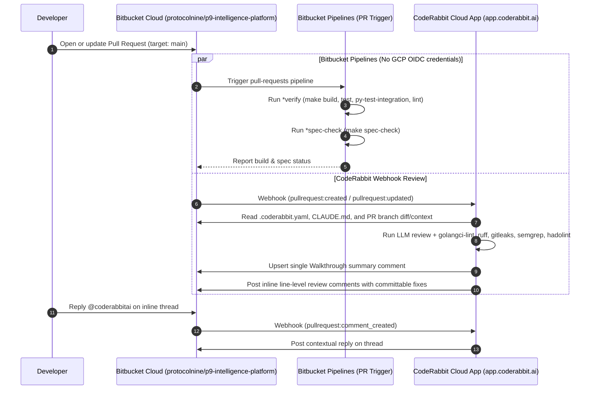

# Spec: Migrate AI PR review from Gemini CLI to CodeRabbit

- **Date:** 2026-11-23
- **Author:** Ghanshyam Kumbhar
- **Ticket:** Pending (see Q-1)
- **Epic:** Pending (see Q-1)
- **Status:** Draft
- **Reviewers:** Sindhu Mandava, Vikram Barate, MJ Berends
- **Related specs:** `openspec/specs/architecture-deployment/spec.md`

Status values: `Draft`, `In review`, `Accepted`, `Implemented`, `Superseded`.

## 1. Problem, Requirements & Scope

Today, every Bitbucket pull request runs the `&ai-review` step (`bitbucket-pipelines.yml:490-520`). That step runs three shell scripts in sequence: `scripts/ci/ai-review-context.sh:1-245`, `scripts/ci/ai-review-run.sh:1-191`, and `scripts/ci/ai-review-post.sh:1-121`. The step installs Node 22 and `@google/gemini-cli` on every run, exchanges the Bitbucket OIDC token for Google Cloud credentials (`scripts/ci/gcp-auth.sh:1-40`), sends a truncated 200 KB diff (`scripts/ci/ai-review-context.sh:48`) to Vertex AI, and posts one combined comment to the pull request (`docs/ai-pr-review-bitbucket.md:3-14`).

This V1 proof of concept has five operational and security gaps documented in `docs/ai-pr-review-bitbucket.md:58-91` and `docs/ai-pr-review-bitbucket.md:429-444`:

1. **Pull request steps hold deployer credentials.** The `&ai-review` step sets `oidc: true` (`bitbucket-pipelines.yml:495`) and impersonates `bitbucket-deployer@ai-proxy-494021.iam.gserviceaccount.com` (`scripts/ci/bootstrap-bitbucket.sh:69`). Because Workload Identity Federation binds to `attribute.repository_uuid` with no branch claim (`docs/ai-pr-review-bitbucket.md:68-84`), any pull request branch that edits `bitbucket-pipelines.yml` or `scripts/ci/ai-review-run.sh` can reach the `p9-dev` GKE cluster and Artifact Registry.
2. **Reviews see only a 200 KB diff without repository context.** Gemini runs inside an empty scratch directory (`scripts/ci/ai-review-run.sh:116-119`) and cannot resolve callers, Go types, or Python imports outside the diff (`ai-review/prompt.md:88-93`).
3. **No inline comments.** `scripts/ci/ai-review-post.sh:114-119` posts one consolidated comment per push rather than line-level comments on the Bitbucket diff (`docs/ai-pr-review-bitbucket.md:438-439`).
4. **Duplicate comments on every push.** Pushing five updates to a pull request creates five separate full review comments (`docs/ai-pr-review-bitbucket.md:435-437`).
5. **Static and security scanners are placeholders.** `SONARQUBE_FINDINGS` and `SECURITY_FINDINGS` in `scripts/ci/ai-review-context.sh:222-229` inject placeholder strings (`docs/ai-pr-review-bitbucket.md:440-443`).

Replacing the pipeline-based Gemini CLI setup with the native CodeRabbit Bitbucket Cloud integration (Option A) and `.coderabbit.yaml` closes all five gaps at once.

### 1.1 Business Requirements

| ID | Who has the problem | Required outcome | Success measure | Source |
|---|---|---|---|---|
| BR-1 | Platform security and CI maintainers | Pull request pipelines in `bitbucket-pipelines.yml` hold no GCP `oidc: true` token and no `BITBUCKET_ACCESS_TOKEN` secret, and `bitbucket-deployer` no longer holds `roles/aiplatform.user`. | Zero steps under `pipelines.pull-requests` in `bitbucket-pipelines.yml` set `oidc: true`, and `gcloud projects get-iam-policy` shows no `roles/aiplatform.user` binding for `bitbucket-deployer`. | `docs/ai-pr-review-bitbucket.md:58-91`, `docs/ai-pr-review-bitbucket.md:431-434` |
| BR-2 | Engineers opening pull requests on Bitbucket | CodeRabbit automatically reviews every non-draft pull request targeting `main`, posts line-level inline comments on the diff, and updates one summary walkthrough comment in place on subsequent pushes. | Opening a pull request and pushing a second commit produces one updated walkthrough comment and inline diff comments on Bitbucket without running a Bitbucket Pipelines review step. | `docs/ai-pr-review-bitbucket.md:435-439` |
| BR-3 | Repository maintainers enforcing P9 architecture rules | `.coderabbit.yaml` enforces the repository file exclusions (vendored `libs/agent-analyzer-py`, lockfiles, checksums, testdata, and generated files), loads `CLAUDE.md` guidelines, enforces module import boundaries, checks Go/Python `agent_job` SQL alignment, checks tenant isolation (`tenantauth.TenantFrom(ctx)` and 404 on cross-tenant access), checks Prometheus label cardinality (`services/intelligence-platform-core/obs/metrics.go:15-30`), and runs built-in static and security analyzers (`golangci-lint`, `ruff`, `gitleaks`, `semgrep`, `hadolint`). | Running `@coderabbitai configuration` on a pull request shows all `path_filters`, `path_instructions`, `knowledge_base`, and `tools` rules active from `.coderabbit.yaml`. | `ai-review/prompt.md:22-82`, `scripts/ci/ai-review-context.sh:120-125` |
| BR-4 | Engineers running pre-PR reviews on a workstation | Developers can run `make ai-review-local` locally through the CodeRabbit CLI against `AI_REVIEW_BASE_BRANCH` (default `main`) without GCP Vertex AI credentials. | `make ai-review-local` invokes `coderabbit review --plain` against the base branch and prints findings to stdout without posting to Bitbucket. | `Makefile:457-460`, `docs/ai-pr-review-bitbucket.md:272-287` |

### 1.2 Scope Boundaries

**In scope**

- Add `.coderabbit.yaml` at the repository root with path exclusions, architecture path instructions, `CLAUDE.md` knowledge-base ingestion, and static/security tool configuration.
- Connect the CodeRabbit Bitbucket Cloud app to `protocolnine/p9-intelligence-platform`.
- Remove the `&ai-review` step, its `pull-requests` reference, and the `ai-review-dry-run` custom pipeline from `bitbucket-pipelines.yml:469-520`, `bitbucket-pipelines.yml:620-626`, and `bitbucket-pipelines.yml:670-682`.
- Remove the Gemini CLI scripts (`scripts/ci/ai-review-context.sh`, `scripts/ci/ai-review-run.sh`, `scripts/ci/ai-review-post.sh`) and prompt template (`ai-review/prompt.md`).
- Remove the five Gemini repository variables from `scripts/ci/bootstrap-bitbucket.sh:54-77`.
- Update `make ai-review-local` in `Makefile:449-460` to run the CodeRabbit CLI.
- Rewrite `docs/ai-pr-review-bitbucket.md:1-444` and update the prose in `openspec/specs/architecture-deployment/spec.md:38` and `openspec/specs/architecture-deployment/spec.md:112-123`.

**Out of scope & Deferred**

- D-1: Blocking pull request merges automatically on CodeRabbit `request_changes_workflow`. Reason: Consistent with `docs/ai-pr-review-bitbucket.md:443-444`, automated AI review remains advisory until the team evaluates false-positive rates on production pull requests.
- D-2: Integrating an external SonarQube server. Reason: CodeRabbit runs built-in static and security scanners (`golangci-lint`, `ruff`, `gitleaks`, `semgrep`, `hadolint`) directly during review.
- D-3: Deploying a self-hosted CodeRabbit appliance inside GKE. Reason: This migration uses the managed CodeRabbit Bitbucket Cloud integration (`app.coderabbit.ai`).

## 2. Consolidated References & Prior Art

| Type | Link or path | Why it matters |
|---|---|---|
| Ticket | `Pending (see Q-1)` | Tracks migrating automated PR code review from Gemini CLI to CodeRabbit. |
| Living spec | `openspec/specs/architecture-deployment/spec.md:34-47` | Lists the Bitbucket Pipelines trigger table including the `pull request` steps. |
| Living spec | `openspec/specs/architecture-deployment/spec.md:112-123` | Describes the current `ai-review` step, its GCP WIF risk, and `make ai-review-local`. |
| Runbook | `docs/ai-pr-review-bitbucket.md:1-444` | Current Gemini CLI architecture, GCP IAM bindings, repository variables, and V1 limitations. |
| Pipeline config | `bitbucket-pipelines.yml:469-520` | Defines the `&ai-review` step with `oidc: true` and `@google/gemini-cli`. |
| Pipeline config | `bitbucket-pipelines.yml:620-626` | Wires `*ai-review` into `pipelines.pull-requests.'**'`. |
| Pipeline config | `bitbucket-pipelines.yml:670-682` | Defines `custom.ai-review-dry-run`. |
| Review prompt | `ai-review/prompt.md:1-134` | Source of repository-specific review instructions and architecture rules to port into `.coderabbit.yaml`. |
| Context script | `scripts/ci/ai-review-context.sh:120-125` | Source of the `EXCLUDE` file glob patterns to port into `.coderabbit.yaml` `reviews.path_filters`. |
| Runner script | `scripts/ci/ai-review-run.sh:1-191` | Current Vertex AI WIF authentication and Gemini CLI invocation being retired. |
| Poster script | `scripts/ci/ai-review-post.sh:1-121` | Current Bitbucket REST API comment poster being retired. |
| Bootstrap script | `scripts/ci/bootstrap-bitbucket.sh:54-77` | Manages unsecured Bitbucket repository variables including the five Gemini review keys. |
| Makefile | `Makefile:449-460` | Defines `ai-review-local` for workstation pre-PR reviews. |
| Metrics rules | `services/intelligence-platform-core/obs/metrics.go:15-30` | Defines the Prometheus metric label cardinality rules enforced during code review. |

## 3. Proposed Architecture & Technical Design

### 3.1 Overview & Key Changes

1. **Native Bitbucket Cloud App Integration (`protocolnine/p9-intelligence-platform`):**
   - Enable the CodeRabbit app at `https://app.coderabbit.ai` for the `protocolnine` Bitbucket workspace and activate `p9-intelligence-platform`.
   - CodeRabbit registers Bitbucket webhooks for pull request creation, commit pushes, and comment replies (`@coderabbitai`).
   - Reviews execute on CodeRabbit infrastructure with full repository checkout context rather than inside a Bitbucket Pipelines runner.

2. **Repository Configuration (`.coderabbit.yaml` at the repo root):**
   - Create `.coderabbit.yaml` validated against `https://coderabbit.ai/integrations/schema.v2.json`.
   - Set `reviews.profile: "chill"` and `reviews.request_changes_workflow: false` so the reviewer focuses on defects rather than style noise and never blocks merges (`ai-review/prompt.md:83-84`, `docs/ai-pr-review-bitbucket.md:443-444`).
   - Configure `reviews.auto_review` with `enabled: true`, `drafts: false`, and `base_branches: ["main"]`.
   - Port all exclusions from `scripts/ci/ai-review-context.sh:120-125` and the generated files list in `CLAUDE.md` into `reviews.path_filters`:
     - `!libs/agent-analyzer-py/**`
     - `!**/*.sum`, `!go.work.sum`
     - `!**/*.lock`, `!**/package-lock.json`
     - `!**/*.pb.go`
     - `!**/testdata/**`
     - `!libs/kep/vocabulary/zz_*.gen.go`
     - `!docs/kep-vocabulary.md`
     - `!services/intelligence-platform-api/docs/openapi.yaml`
     - `!web/console/src/api/schema.d.ts`
     - `!docs/architecture/CHANGELOG.md`
   - Port all project rules from `ai-review/prompt.md:22-82` into `reviews.path_instructions`:
     - Global (`**/*`): functional bugs, security, authz/authn, injection, secret exposure, error handling, races, resource leaks, missing tests; tenant read only via `tenantauth.TenantFrom(ctx)` and cross-tenant lookup returning 404, never 403.
     - `libs/classification/**` and `libs/mcp-connector/**`: neither library may import the other or any package under `services/`.
     - `services/intelligence-platform-core/store/migrations/**` and `services/python-agent-worker/**`: changes to `agent_job` or `repo_dependency_*` tables must keep Go goose migrations and Python raw SQL synchronized in the same release; Python code must import `analyze_repo` from `p9_repodep`, never `code_analyzer`.
     - `services/**/obs/**`: Prometheus metric labels must never include `job_id`, `phase`, or error messages (`services/intelligence-platform-core/obs/metrics.go:15-30`).
   - Enable `knowledge_base.code_guidelines` with `filePatterns: ["**/CLAUDE.md"]` so CodeRabbit reads every module's `CLAUDE.md`.
   - Enable built-in static and security scanners under `reviews.tools`: `golangci-lint`, `ruff`, `gitleaks`, `semgrep`, and `hadolint`.

3. **Pipeline Isolation (`bitbucket-pipelines.yml:469-520`, `bitbucket-pipelines.yml:620-626`, `bitbucket-pipelines.yml:670-682`):**
   - Delete the `&ai-review` step (`bitbucket-pipelines.yml:490-520`) and its comment block (`bitbucket-pipelines.yml:469-489`).
   - Update `pipelines.pull-requests.'**'` (`bitbucket-pipelines.yml:620-626`) to run only `*verify` and `*spec-check` in parallel, and update the comment block above it (`bitbucket-pipelines.yml:600-619`) to state that pull request steps once again hold zero GCP credentials (`oidc: true` is absent from all PR steps).
   - Delete `pipelines.custom.ai-review-dry-run` (`bitbucket-pipelines.yml:670-682`).
   - Update the comment in `&spec-check` (`bitbucket-pipelines.yml:321`) so it no longer references `ai-review-context.sh`.

4. **Script, Variable, and Makefile Cleanup:**
   - Delete `ai-review/prompt.md`, `scripts/ci/ai-review-context.sh`, `scripts/ci/ai-review-run.sh`, and `scripts/ci/ai-review-post.sh`.
   - Remove `ai-review/out` from `.dockerignore:24-28` and `.gitignore:68`.
   - Remove `GCP_REVIEW_SERVICE_ACCOUNT`, `GCP_REVIEW_WORKLOAD_IDENTITY_PROVIDER`, `GOOGLE_CLOUD_LOCATION`, `GEMINI_MODEL`, and `AI_REVIEW_SOFT_FAIL` from `REPO_VAR_KEYS` and `REPO_VAR_VALS` in `scripts/ci/bootstrap-bitbucket.sh:54-77`.
   - Update `ai-review-local` in `Makefile:449-460` to invoke `coderabbit review --plain --base "$${AI_REVIEW_BASE_BRANCH:-main}"`.
   - Update the comment in `tools/spectool/internal/specfs/config.go:10` that mentions `scripts/ci/ai-review-context.sh`.

### 3.2 System & Data Flow

### 3.3 What Stays the Same

- **PR Verification Gates:** `pipelines.pull-requests.'**'` (`bitbucket-pipelines.yml:620-626`) continues to run `*verify` and `*spec-check` in parallel as blocking merge checks.
- **Advisory AI Review:** CodeRabbit reviews do not block pull request merges (`request_changes_workflow: false`), preserving the non-blocking posture of `docs/ai-pr-review-bitbucket.md:443-444`.
- **Deploy WIF Authentication:** `scripts/ci/gcp-auth.sh:1-40` and the `GCP_PROJECT_ID`, `GCP_WORKLOAD_IDENTITY_PROVIDER`, `GCP_SERVICE_ACCOUNT`, `AR_LOCATION`, and `AR_REPOSITORY` variables in `scripts/ci/bootstrap-bitbucket.sh:54-65` remain unchanged for `&build-and-push` and `&deploy-staging`.
- **Workstation Command Name:** The `make ai-review-local` target name in `Makefile:154` and `Makefile:457` stays the same so developer muscle memory does not change.

### 3.4 Alternatives Rejected

| Option | Why rejected |
|---|---|
| Option B: Run `coderabbit review --plain` CLI inside the Bitbucket Pipelines `&ai-review` step and post via `scripts/ci/ai-review-post.sh` | Exposes `CODERABBIT_API_KEY` and `BITBUCKET_ACCESS_TOKEN` to untrusted PR branch scripts in CI, posts one flat comment per push instead of incremental updates and inline diff comments, disables `@coderabbitai` PR chat, and consumes Bitbucket Pipelines runner minutes on every push. |
| Keep `@google/gemini-cli` on Vertex AI with a dedicated `bitbucket-ai-reviewer` GCP service account (`docs/ai-pr-review-bitbucket.md:93-122`) | Closes only the GKE/Artifact Registry privilege escalation risk (`BR-1`), while leaving the 200 KB diff-only context limit, lack of inline comments (`BR-2`), duplicate comments on every push (`BR-2`), and unimplemented static/security scanner placeholders (`BR-3`). |

## 4. Tenancy, Security & Operational Boundaries

Not applicable: This change modifies CI pipeline definitions, repository review configuration, and developer tooling only. It touches no application service, database table, KEP observation, or HTTP route.

### 4.1 Tenancy & Data Isolation

Not applicable: No database tables, queries, or tenant-scoped API routes are read or written.

### 4.2 Security & Rate Limits

- **Removal of GCP OIDC from Pull Requests (`BR-1`):** Removing `&ai-review` removes `oidc: true` from `pipelines.pull-requests` (`bitbucket-pipelines.yml:495`). Pull request steps can no longer exchange a `BITBUCKET_STEP_OIDC_TOKEN` for `bitbucket-deployer` credentials, closing the cluster and Artifact Registry exposure described in `docs/ai-pr-review-bitbucket.md:58-91`.
- **Revocation of Unused IAM Role and Bitbucket Secrets (`BR-1`):** `roles/aiplatform.user` is removed from `bitbucket-deployer@ai-proxy-494021.iam.gserviceaccount.com` on GCP project `ai-proxy-494021`. The Repository Access Token stored in `BITBUCKET_ACCESS_TOKEN` (`docs/ai-pr-review-bitbucket.md:185-194`) is deleted from Bitbucket Repository Variables and revoked under Repository Access Tokens.
- **Least-Privilege Bitbucket OAuth Grant:** The CodeRabbit Bitbucket app uses OAuth scopes limited to reading repository contents and reading/writing pull request comments on enabled repositories.
- **Source Code Data Handling:** CodeRabbit processes pull request files in ephemeral, isolated environments with zero code retention after review completion and does not train models on customer code.

## 5. Migrations, Rollout & Compatibility

### 5.1 Schema Migrations & Data Backfill

Not applicable: No database schema or KEP kind changes are required.

### 5.2 Mixed-Version Compatibility & Rollout Matrix

| Case | Behavior |
|---|---|
| Old code with new schema | Not applicable: no database schema change. |
| New code with old schema | Not applicable: no database schema change. |
| Jobs in flight during rollout (River, Temporal, `agent_job`) | Not applicable: application workers are unaffected. Open pull requests whose pipeline started before the merge finish their in-flight `&ai-review` step normally. |
| Old API client with new API | Not applicable: no API change. |
| Feature flag or config switch | Repository toggle in `https://app.coderabbit.ai` plus `reviews.auto_review.enabled` in `.coderabbit.yaml`. Enable the CodeRabbit app in Step 5 after merging `.coderabbit.yaml` and removing `&ai-review`, so a pull request does not receive both Gemini and CodeRabbit reviews at the same time. |
| Rollback of code only | Disable the repository toggle in `https://app.coderabbit.ai`, revert the commit removing `&ai-review` and `scripts/ci/ai-review-*.sh`, recreate `BITBUCKET_ACCESS_TOKEN`, and re-run `./scripts/ci/bootstrap-bitbucket.sh --apply`. Nothing in application state is lost. |
| Rollback of code and migration | Not applicable: no migration. |

### 5.3 Cross-Language Contracts

Not applicable: No Go, Python, or TypeScript runtime contracts are modified.

## 6. Implementation Plan & Code Touchpoints

### 6.1 Code Touchpoints & Impact Analysis

| Area | Search or command | Result |
|---|---|---|
| Callers and references to `ai-review` | `git grep -n "ai-review"` | `.dockerignore:24-28`, `.gitignore:68`, `Makefile:154`, `Makefile:449-460`, `bitbucket-pipelines.yml:321`, `bitbucket-pipelines.yml:480-520`, `bitbucket-pipelines.yml:624`, `bitbucket-pipelines.yml:670-682`, `docs/ai-pr-review-bitbucket.md:1-444`, `openspec/specs/architecture-deployment/spec.md:38`, `openspec/specs/architecture-deployment/spec.md:112-123`, `scripts/ci/ai-review-context.sh:1-245`, `scripts/ci/ai-review-run.sh:1-191`, `scripts/ci/ai-review-post.sh:1-121`, `tools/spectool/internal/specfs/config.go:10` |
| References to Gemini / Vertex review variables | `git grep -n "GEMINI_MODEL\|GCP_REVIEW_\|AI_REVIEW_"` | `Makefile:458-460`, `docs/ai-pr-review-bitbucket.md:95-296`, `scripts/ci/ai-review-context.sh:40-203`, `scripts/ci/ai-review-post.sh:29-89`, `scripts/ci/ai-review-run.sh:12-159`, `scripts/ci/bootstrap-bitbucket.sh:49-77` |
| Tables read or written | None | None |
| Public routes and `openapi.yaml` | None | None |
| Generated files | `make spec-changelog` (when archiving OpenSpec prose update, if applicable) | `docs/architecture/CHANGELOG.md` |
| Other languages (Python, TypeScript) | None | None |
| Config keys and environment variables | Bitbucket repository variables in `scripts/ci/bootstrap-bitbucket.sh:54-77` | Remove `GCP_REVIEW_SERVICE_ACCOUNT`, `GCP_REVIEW_WORKLOAD_IDENTITY_PROVIDER`, `GOOGLE_CLOUD_LOCATION`, `GEMINI_MODEL`, `AI_REVIEW_SOFT_FAIL` |

### 6.2 Step-by-Step Implementation Steps

1. **Step 1: Add `.coderabbit.yaml` to the repository root**
   - **Files touched:** `.coderabbit.yaml` (new), `ai-review/prompt.md:22-82`, `scripts/ci/ai-review-context.sh:120-125`
   - **Depends on:** None
   - **Details:** Create `.coderabbit.yaml` containing `reviews.profile: "chill"`, `reviews.auto_review` targeting `main`, `reviews.path_filters` ported from `scripts/ci/ai-review-context.sh:120-125` and `CLAUDE.md`, `reviews.path_instructions` ported from `ai-review/prompt.md:22-82`, `reviews.tools` (`golangci-lint`, `ruff`, `gitleaks`, `semgrep`, `hadolint`), and `knowledge_base.code_guidelines` pointing to `**/CLAUDE.md`.
   - **Verified by:** AC-2, AC-3

2. **Step 2: Remove `&ai-review` and `ai-review-dry-run` from `bitbucket-pipelines.yml`**
   - **Files touched:** `bitbucket-pipelines.yml:321`, `bitbucket-pipelines.yml:469-520`, `bitbucket-pipelines.yml:600-626`, `bitbucket-pipelines.yml:670-682`
   - **Depends on:** Step 1
   - **Details:** Delete the `&ai-review` step definition (`bitbucket-pipelines.yml:469-520`), remove `- step: *ai-review` from `pipelines.pull-requests.'**'` (`bitbucket-pipelines.yml:624`), update the security comment above `pull-requests` (`bitbucket-pipelines.yml:600-619`) to reflect that PR pipelines no longer hold `oidc: true`, delete `custom.ai-review-dry-run` (`bitbucket-pipelines.yml:670-682`), and remove the stale `see ai-review-context.sh` parenthetical in `bitbucket-pipelines.yml:321`.
   - **Verified by:** AC-1

3. **Step 3: Remove Gemini review scripts, prompt, and bootstrap variables, and update `Makefile`**
   - **Files touched:** `ai-review/prompt.md:1-134`, `scripts/ci/ai-review-context.sh:1-245`, `scripts/ci/ai-review-run.sh:1-191`, `scripts/ci/ai-review-post.sh:1-121`, `scripts/ci/bootstrap-bitbucket.sh:49-77`, `Makefile:449-460`, `.dockerignore:24-28`, `.gitignore:68`, `tools/spectool/internal/specfs/config.go:10`
   - **Depends on:** Step 2
   - **Details:** Delete `ai-review/prompt.md` and `scripts/ci/ai-review-{context,run,post}.sh`. Remove the five Gemini variables from `REPO_VAR_KEYS` and `REPO_VAR_VALS` in `scripts/ci/bootstrap-bitbucket.sh:54-77`. Update `ai-review-local` in `Makefile:449-460` to run `coderabbit review --plain --base "$${AI_REVIEW_BASE_BRANCH:-main}"`. Clean up `ai-review/out` in `.dockerignore:24-28` and `.gitignore:68`, and update the comment in `tools/spectool/internal/specfs/config.go:10`.
   - **Verified by:** AC-1, AC-4

4. **Step 4: Update runbook and living architecture spec prose**
   - **Files touched:** `docs/ai-pr-review-bitbucket.md:1-444`, `openspec/specs/architecture-deployment/spec.md:38`, `openspec/specs/architecture-deployment/spec.md:112-123`
   - **Depends on:** Step 2, Step 3
   - **Details:** Rewrite `docs/ai-pr-review-bitbucket.md` to cover the CodeRabbit Bitbucket Cloud integration, `.coderabbit.yaml` structure, `@coderabbitai` PR commands, and `make ai-review-local`. Update the pipeline table (`openspec/specs/architecture-deployment/spec.md:38`) and prose (`openspec/specs/architecture-deployment/spec.md:112-123`) so the living spec matches the repository (`Spec-Decision: none` and `Spec-Impact: none` as no normative requirement changes).
   - **Verified by:** AC-5

5. **Step 5: Enable CodeRabbit in Bitbucket Cloud and revoke legacy GCP/Bitbucket credentials**
   - **Files touched:** External configuration in `https://app.coderabbit.ai`, Bitbucket Repository Settings, and GCP project `ai-proxy-494021` (`docs/ai-pr-review-bitbucket.md:114-118`, `docs/ai-pr-review-bitbucket.md:204-212`)
   - **Depends on:** Step 1, Step 2, Step 3, Step 4
   - **Details:** Enable `protocolnine/p9-intelligence-platform` in the CodeRabbit dashboard. Revoke `roles/aiplatform.user` from `bitbucket-deployer@ai-proxy-494021.iam.gserviceaccount.com`. Delete `BITBUCKET_ACCESS_TOKEN`, `GCP_REVIEW_SERVICE_ACCOUNT`, `GCP_REVIEW_WORKLOAD_IDENTITY_PROVIDER`, `GOOGLE_CLOUD_LOCATION`, `GEMINI_MODEL`, and `AI_REVIEW_SOFT_FAIL` from Bitbucket Repository Variables, and revoke the Repository Access Token.
   - **Verified by:** AC-1, AC-2, AC-3

## 7. Verification, Acceptance Criteria & Test Matrix

### 7.1 Requirements Traceability

| BR | Design section | Code change (file, symbol) | Acceptance criterion | Test |
|---|---|---|---|---|
| BR-1 | 3.1, 4.2 | `bitbucket-pipelines.yml:490-520` (`&ai-review`), `bitbucket-pipelines.yml:620-626` (`pull-requests`), `scripts/ci/bootstrap-bitbucket.sh:54-77` (`REPO_VAR_KEYS`) | AC-1 | Pipeline YAML parse + OIDC/variable audit (`shellcheck` and `python3` YAML check) |
| BR-2 | 3.1, 3.2 | `.coderabbit.yaml` (`reviews.auto_review`) | AC-2 | Bitbucket PR webhook verification on test PR |
| BR-3 | 3.1 | `.coderabbit.yaml` (`reviews.path_filters`, `reviews.path_instructions`, `reviews.tools`, `knowledge_base`) | AC-3 | `.coderabbit.yaml` schema validation + `@coderabbitai configuration` PR check |
| BR-4 | 3.1, 3.3 | `Makefile:457-460` (`ai-review-local`) | AC-4, AC-5 | `make -n ai-review-local` and `make spec-check` |

### 7.2 Acceptance Criteria

- **AC-1:** Given `bitbucket-pipelines.yml` and `scripts/ci/bootstrap-bitbucket.sh`, when inspected with `python3 -c 'import yaml'` and `shellcheck`, then `pipelines.pull-requests.'**'` contains only `*verify` and `*spec-check`, no pull-request step sets `oidc: true`, `ai-review/prompt.md` and `scripts/ci/ai-review-{context,run,post}.sh` no longer exist, and `scripts/ci/bootstrap-bitbucket.sh` defines only the 5 deploy repository variables.
- **AC-2:** Given the CodeRabbit app enabled on `protocolnine/p9-intelligence-platform`, when a non-draft pull request targeting `main` is opened and updated with a second commit, then CodeRabbit posts inline review comments on the diff and updates one Walkthrough summary comment in place.
- **AC-3:** Given `.coderabbit.yaml` at the repository root, when validated against the CodeRabbit v2 JSON schema and inspected via `@coderabbitai configuration` on a pull request, then all 12 `path_filters` exclusions, all 6 `path_instructions` rules, `knowledge_base.code_guidelines` (`**/CLAUDE.md`), and the 5 static/security tools (`golangci-lint`, `ruff`, `gitleaks`, `semgrep`, `hadolint`) are active.
- **AC-4:** Given the updated `Makefile`, when a developer runs `make -n ai-review-local`, then Make expands to `coderabbit review --plain --base "${AI_REVIEW_BASE_BRANCH:-main}"` with no dependency on `gcloud` or `@google/gemini-cli`.
- **AC-5:** Given all changes committed with trailers `Spec-Impact: none` and `Spec-Decision: none`, when `make spec-check` runs, then every OpenSpec and `spectool` gate passes with exit code 0.

### 7.3 Test Matrix & Execution

| AC | Level (unit, db, integration, e2e, manual) | Test or steps | Command |
|---|---|---|---|
| AC-1 | unit | Parse `bitbucket-pipelines.yml`, verify no PR step has `oidc: true`, and lint `scripts/ci/bootstrap-bitbucket.sh` | `python3 -c 'import yaml,sys; d=yaml.safe_load(open("bitbucket-pipelines.yml")); assert all(not s.get("step",{}).get("oidc") for p in d["pipelines"]["pull-requests"]["**"] for s in p.get("parallel",[]))' && shellcheck -S warning scripts/ci/*.sh` |
| AC-2 | manual | Open a test PR targeting `main`, push a second commit, and verify one updated Walkthrough comment plus inline diff comments | Open PR in Bitbucket UI |
| AC-3 | unit / manual | Validate `.coderabbit.yaml` YAML syntax and post `@coderabbitai configuration` on the test PR | `python3 -c 'import yaml; d=yaml.safe_load(open(".coderabbit.yaml")); assert len(d["reviews"]["path_filters"]) == 12 and len(d["reviews"]["path_instructions"]) == 6'` |
| AC-4 | unit | Verify `ai-review-local` dry-run command expansion | `make -n ai-review-local` |
| AC-5 | integration | Run repository spec gates and CI helper unit tests | `make spec-check && python3 scripts/ci/test-update-config-dev.py && python3 scripts/ci/test-chart-gitops.py` |

Existing CI unit tests in `scripts/ci/test-update-config-dev.py:43-116` and `scripts/ci/test-chart-gitops.py:1-79` must stay green.

## 8. Risks, Failure Modes & Open Questions

### 8.1 Risks & Mitigations

| Risk | Likelihood and effect | Mitigation |
|---|---|---|
| R-1: CodeRabbit app is enabled before `&ai-review` is removed from `bitbucket-pipelines.yml`, causing duplicate reviews (both Gemini and CodeRabbit comment on the same PR) | Medium likelihood during cutover; low impact (noise on open PRs). | Follow the Step 1-5 execution order in Section 6.2: merge the PR that adds `.coderabbit.yaml` and removes `&ai-review` first, then toggle the repository on in `https://app.coderabbit.ai` in Step 5. |
| R-2: `.coderabbit.yaml` contains a syntax or schema typo, causing CodeRabbit to fall back to default settings and review vendored files under `libs/agent-analyzer-py/` | Low likelihood; produces noisy inline comments on vendored files. | Include the `# yaml-language-server: $schema=https://coderabbit.ai/integrations/schema.v2.json` header in `.coderabbit.yaml`, run the YAML assertion in AC-3 before merging, and run `@coderabbitai configuration` on the first PR. |
| R-3: CodeRabbit service outage delays automated review comments | Low likelihood; could stall developers if review status were a required merge check. | Keep `reviews.request_changes_workflow: false` in `.coderabbit.yaml` and do not mark CodeRabbit as a blocking Bitbucket merge check (D-1). |

### 8.2 Open Questions

- Q-1: What is the Jira ticket key (in the `KAN` or `IP` project) for this migration so it can be recorded in the spec header? Owner: Ghanshyam Kumbhar. Needed before: Moving status from `Draft` to `In review`.
- Q-2: Has the security/compliance reviewer approved connecting the managed CodeRabbit Bitbucket Cloud OAuth app (`https://app.coderabbit.ai`) to the `protocolnine` workspace? Owner: Ghanshyam Kumbhar. Needed before: Step 5 cutover.
